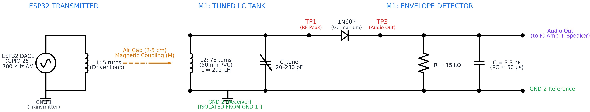
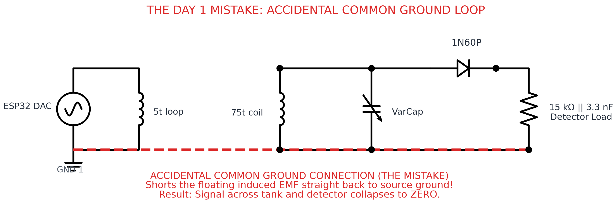

# 📻 DIY AM Radio — Milestone 1: Tuner & Detector

> **Course:** ELEG103 Analog and Digital Electronics · SBME Department  
> **Milestone:** M1 — The Tuned LC Tank Circuit and Peak Envelope Detector  
> **Target Carrier Frequency:** 700 kHz (AM Medium-Wave Band)  
> **Modulating Audio Tone:** 1 kHz / 2 kHz Sine Wave ($m = 70\%$)  
> **Live Web Guide:** [View on GitHub Pages](https://mhmdsheref.github.io/DIY-AM-Radio/)

---

## 📌 1. Project Overview

Every amplitude-modulation (AM) radio receiver begins with two foundational stages:
1. **The Tuned Tank Circuit ($LC$ resonator):** Selects one desired transmission frequency out of all incoming electromagnetic signals while rejecting out-of-band interference.
2. **The Envelope Detector (Peak Rectifier):** Strips away the high-frequency RF carrier wave to recover the underlying low-frequency information (the audio tone).

### Milestone 1 Schematic Diagram

Below is the complete schematic for Milestone 1, showing the ESP32 transmitter stage, air-core magnetic inductive link, resonant $LC$ tank, germanium peak envelope detector, and audio output stage:


<div class="image-caption">Figure 1: Full schematic diagram for Milestone 1, generated programmatically using schemdraw.</div>

---

## 📐 2. Theoretical Design & Mathematical Predictions

### 2.1 Inductance of the Hand-Wound Coil
The receiver coil was hand-wound using 0.3 mm enamelled copper wire over a 50 mm outer-diameter polyvinyl chloride (PVC) pipe. The coil consists of $n = 75$ close-wound turns spanning a length of $l = 25\text{ mm}$.

Using **Wheeler’s formula** for a single-layer cylindrical air-core coil:

$$
L \approx \frac{d^2 \cdot n^2}{457 d + 1016 l} \quad [\mu\text{H}]
$$

Where:
* $d = 50\text{ mm}$ (coil diameter)
* $l = 25\text{ mm}$ (coil length)
* $n = 75\text{ turns}$

Plugging in the parameters:

$$
L \approx \frac{50^2 \times 75^2}{457(50) + 1016(25)} = \frac{2500 \times 5625}{22850 + 25400} = \frac{14{,}062{,}500}{48{,}250} \approx 291.5\,\mu\text{H}
$$

### 2.2 Tunable Frequency Band
The coil is placed in parallel with a variable capacitor whose AM section spans $C_{\text{min}} = 20\text{ pF}$ to $C_{\text{max}} = 280\text{ pF}$. The resonant frequency is given by Thomson's resonance formula:

$$
f_0 = \frac{1}{2\pi \sqrt{L C}}
$$

* **Low-frequency end ($C = 280\text{ pF}$):**

$$
f_{\text{low}} = \frac{1}{2\pi \sqrt{291.5\times 10^{-6} \times 280\times 10^{-12}}} \approx 557.1\,\text{kHz}
$$

* **High-frequency end ($C = 20\text{ pF}$):**

$$
f_{\text{high}} = \frac{1}{2\pi \sqrt{291.5\times 10^{-6} \times 20\times 10^{-12}}} \approx 2.085\,\text{MHz}
$$

* **Tuning to the Target Station (819 kHz):**  
  To tune into 819 kHz (the classic Egyptian medium-wave transmitter frequency):

$$
C = \frac{1}{(2\pi f_0)^2 L} = \frac{1}{(2\pi \times 819\times 10^3)^2 \times 291.5\times 10^{-6}} \approx 129.6\,\text{pF}
$$

*(Well within the $20\text{--}280\text{ pF}$ travel range, near the center position).*

### 2.3 Detector Filter Time Constant
The envelope detector uses a point-contact germanium diode (**1N60P**), loaded by a parallel $R = 15\text{ k}\Omega$ resistor and $C = 3.3\text{ nF}$ capacitor:

$$
\tau = R \cdot C = 15\times 10^3\,\Omega \times 3.3\times 10^{-9}\,\text{F} = 49.5\,\mu\text{s} \approx 50\,\mu\text{s}
$$

For distortion-free envelope detection without diagonal clipping or carrier ripple:

$$
\frac{1}{f_c} \ll \tau \ll \frac{1}{f_m}
$$

* Carrier period: $\frac{1}{700\text{ kHz}} \approx 1.43\,\mu\text{s}$
* Filter time constant: $\tau \approx 49.5\,\mu\text{s}$
* Audio modulation period: $\frac{1}{1\text{ kHz}} = 1000\,\mu\text{s}$

Since $1.43\,\mu\text{s} \ll 49.5\,\mu\text{s} \ll 1000\,\mu\text{s}$, the filter suppresses the 700 kHz carrier ripples while following the audio envelope without diagonal distortion.

| Parameter | Theoretical Prediction |
| :--- | :--- |
| **Coil Inductance ($L$)** | $291.5\,\mu\text{H}$ |
| **Band Low End ($f$ at $280\text{ pF}$)** | $557.1\text{ kHz}$ |
| **Band High End ($f$ at $20\text{ pF}$)** | $2.085\text{ MHz}$ |
| **Capacitance for $819\text{ kHz}$** | $129.6\text{ pF}$ |
| **Detector Time Constant ($RC$)** | $49.5\,\mu\text{s}$ |

---

## 🧪 3. The Engineering Journey & Troubleshooting

### 3.1 Day 1: Wave Generation & The Common Ground Trap
We began by creating our AM test signal. Because laboratory function generators were limited in output voltage and laptop audio sound cards are capped at 20 kHz (far short of the required 700 kHz AM broadcast carrier), we used an **ESP32** microcontroller. We configured its built-in digital-to-analog converter (DAC) on GPIO 25 to output a synthesized AM wave:

$$
s(t) = \left[1 + m \cdot \sin(2\pi f_{\text{audio}} t)\right] \cdot \sin(2\pi f_{\text{carrier}} t)
$$

We built a preliminary filtering circuit on the DAC output (a series DC-blocking capacitor, parallel RC filter) and drove our 5-turn test loop.
* Across the isolated transmitter loop, the wave looked healthy on the scope.
* **The Problem:** The instant we connected the output to the receiver/detector cleanup circuit, **the signal collapsed completely to zero**.

#### Root Cause Analysis: The Ground Loop Bug
We had connected both the ESP32 transmitter circuit and the receiver tank circuit to a **common breadboard ground**. In an inductively coupled RF link, the secondary tank circuit must remain floating with respect to the primary driver. Tying their grounds together created a massive ground loop that shunted the magnetically induced EMF straight back to ground:


<div class="image-caption">Figure 2: The Day 1 common ground mistake. Tying transmitter GND1 and receiver GND2 together created a ground loop that shorted out the floating induced voltage.</div>

---

### 3.2 Late-Night Improvised Scope: The ESP32 ADC
Diagnosing the ground loop took us well past laboratory closing hours, and access to the bench oscilloscopes was revoked for the evening. 

Refusing to stop blind, we turned to a second ESP32. We configured its internal analog-to-digital converter (ADC) as a makeshift digital oscilloscope streaming high-speed samples over serial to a desktop plotting interface:


<div class="image-caption">Figure 3: Improvised late-night signal capture using a second ESP32 ADC as a makeshift oscilloscope.</div>

Although resolution was coarse and ADC sampling noise was prominent, this hack confirmed that our transmitter was outputting energy and oscillating, giving us a baseline to start Day 2.

---

### 3.3 Day 2: The 2 kHz Sample Rate Bug & The I2S DMA Fix
On Day 2, we severed the common ground connection. However, the received signal was still weak, noisy, and unresponsive to variable capacitor tuning.

Inspecting our initial ESP32 code revealed a fatal software flaw:
* Our original implementation relied on software timer interrupts / `dacWrite()` loops. 
* Due to FreeRTOS context switching overhead, the actual effective sample rate was far lower than calculated. We were unintentionally transmitting an **RF carrier of only $\sim 2\text{ kHz}$**!
* An air-core coil of $\sim 292\,\mu\text{H}$ offers negligible reactance at $2\text{ kHz}$ ($\omega L \approx 3.7\,\Omega$), virtually shorting the driver and failing to radiate magnetically.

#### The Overhaul: ESP32 I2S DMA Engine
We completely redesigned the transmitter firmware to bypass CPU intervention entirely:
1. We utilized the ESP32’s **I2S0 hardware peripheral in built-in DAC mode** (`I2S_MODE_DAC_BUILT_IN`).
2. We configured Direct Memory Access (DMA) running at **2.8 MSPS** ($2{,}800{,}000\text{ samples/sec}$).
3. At 2.8 MSPS, exactly **4 samples define one cycle of a 700 kHz carrier**:

$$
\frac{2{,}800{,}000\text{ Hz}}{700{,}000\text{ Hz}} = 4.0\text{ samples/cycle}
$$

4. With a 1 kHz modulation period, a cyclic buffer of exactly 2800 samples streams continuously from DMA memory to the DAC with zero CPU latency or jitter.

---

### 3.4 Isolating the Detector: The Transformer Test & Diode Clipping
To confirm that our envelope detector (1N60P diode + RC filter) was operating correctly independent of air-core coil alignment, we temporarily replaced the coils with a store-bought iron-core transformer.

The high coupling coefficient of the transformer stepped up the voltage sufficiently to cross the forward threshold voltage ($V_f \approx 0.25\text{ V}$) of the germanium diode:


<div class="image-caption">Figure 4: Verifying detector clipping with a coupling transformer. The yellow trace shows clean half-wave rectification and envelope peak tracking.</div>

As captured on the Owon oscilloscope (Figure 4):
* The blue trace demonstrates the high-amplitude AM carrier delivered by the transformer.
* The yellow trace confirms clear diode clipping on the negative halves of the cycle and smooth envelope following across the positive peaks. This isolated test proved our detector topology was working.

---

### 3.5 Resonant Tuning with the VarCap (In-Sync vs. Out-of-Sync)
Returning to our hand-wound 75-turn coil and 5-turn driver loop, we tuned the variable capacitor across its travel to match the 700 kHz transmission:

| Out of Sync (Detuned Tank) | In Sync (Resonant Tank) |
| :---: | :---: |
|  |  |
| **Off-Resonance:** $V_{pp} \approx 83\text{--}177\text{ mV}$ | **On-Resonance (700 kHz):** $V_{pp} \approx \mathbf{703.1\text{ mV}}$ |

* **Detuned ($C \neq C_0$):** High impedance mismatch; the tank attenuates the signal down to noise levels ($< 180\text{ mV}$).
* **Tuned ($C = C_0$):** At resonance, inductive and capacitive reactances cancel ($\omega_0 L = \frac{1}{\omega_0 C}$), developing a sharp voltage rise to **$703.1\text{ mV}_{pp}$** across TP1.

---

### 3.6 Final Waveform & The Speaker Test
With the coils aligned and tuned in resonance, we observed our final received signal at the bench:


<div class="image-caption">Figure 5: Final unclipped transmission captured on the Owon SDS1102 oscilloscope. Channel 1 (Yellow): Detected envelope (1.002 kHz, 1.18 Vpp). Channel 2 (Blue): Resonant 700 kHz AM wave packet (812.5 mVpp).</div>

#### Waveform Analysis
* **Blue Trace (CH2, $200\,\text{mV/div}$, Timebase $200\,\mu\text{s}$):** Displays the received 700 kHz AM wave packet with smooth modulation envelope ($V_{pp} = 812.5\text{ mV}$).
* **Yellow Trace (CH1):** Shows the extracted envelope tone cleanly oscillating at $f = 1.002\text{ kHz}$ ($V_{pp} = 1.180\text{ V}$).
* **Why Unclipped?** Unlike the high-voltage transformer test, the air-coupled coil delivers an induced EMF of $\sim 400\text{ mV}$ peak. This voltage operates near the gentle curvature of the 1N60P diode characteristic, preserving the complete envelope shape without hard saturation clipping.

#### 🔊 The Ultimate Test
To test the output beyond the oscilloscope, we connected TP3 into an audio IC amplifier driving a desktop speaker:
> **The 1 kHz audio tone was clearly audible across the room!** The transmitter beamed the tone through the air from the ESP32 to the passive tank, and the detector recovered the audio signal.

---

## 💻 4. ESP32 Transmitter Firmware

The transmitter code uses ESP-IDF I2S DMA streaming to output an AM modulated carrier on GPIO 25:

```cpp
#include <Arduino.h>
#include "driver/i2s.h"
#include <math.h>

#define SAMPLE_RATE       2800000   // 2.8 MSPS (4 samples per 700 kHz cycle)
#define CARRIER_FREQ      700000    // 700 kHz AM carrier
#define AUDIO_FREQ        2000      // Audio modulation tone
#define NUM_SAMPLES       (SAMPLE_RATE / AUDIO_FREQ) // Exactly 2800 samples

// Buffer storing 16-bit frames for I2S DAC mode
uint16_t dma_buffer[NUM_SAMPLES];

void setup() {
  Serial.begin(115200);
  delay(500);

  const float m = 0.70; // 70% modulation index
  
  for (int i = 0; i < NUM_SAMPLES; i++) {
    float t = (float)i / SAMPLE_RATE;

    // Synthesis formulas
    float audio   = sinf(2.0f * (float)M_PI * AUDIO_FREQ * t);
    float carrier = sinf(2.0f * (float)M_PI * CARRIER_FREQ * t);

    // Standard AM equation: (1 + m * s_m(t)) * c(t)
    float am_val = (1.0f + m * audio) * carrier; 

    // Scale to fit 8-bit DAC range (centered at 128)
    int dac_val = (int)(128.0f + am_val * 65.0f);
    dac_val = constrain(dac_val, 0, 255);

    // High byte maps directly to ESP32 internal 8-bit DAC
    dma_buffer[i] = ((uint16_t)dac_val) << 8;
  }

  i2s_config_t i2s_config = {
    .mode                 = (i2s_mode_t)(I2S_MODE_MASTER | I2S_MODE_TX | I2S_MODE_DAC_BUILT_IN),
    .sample_rate          = SAMPLE_RATE,
    .bits_per_sample      = I2S_BITS_PER_SAMPLE_16BIT,
    .channel_format       = I2S_CHANNEL_FMT_ONLY_RIGHT, // DAC1 (GPIO25)
    .communication_format = I2S_COMM_FORMAT_STAND_MSB,
    .intr_alloc_flags     = ESP_INTR_FLAG_LEVEL1,
    .dma_buf_count        = 4,
    .dma_buf_len          = 700,                        // 700 * 4 = 2800 frames total
    .use_apll             = false                       // Must be false: APLL cannot synthesize 2.8 MHz
  };

  i2s_driver_install(I2S_NUM_0, &i2s_config, 0, NULL);
  i2s_set_dac_mode(I2S_DAC_CHANNEL_RIGHT_EN); // Enable GPIO25
  i2s_set_sample_rates(I2S_NUM_0, SAMPLE_RATE);
  i2s_zero_dma_buffer(I2S_NUM_0);

  Serial.println("Transmitting AM signal on GPIO 25 (DAC1) at 700 kHz...");
}

void loop() {
  size_t bytes_written = 0;
  // Continuously push buffer via DMA with zero CPU intervention
  i2s_write(I2S_NUM_0, dma_buffer, sizeof(dma_buffer), &bytes_written, portMAX_DELAY);
}
```

---

## 🎨 5. How to Easily Draw Real Circuit Diagrams

To replace ASCII sketches with publication-quality schematics, you don't need heavy CAD suites like Altium or KiCad. Two fast approaches work best:

### Approach A: Python `schemdraw` (Used in this Guide)
The Python library `schemdraw` lets you write schematic diagrams programmatically in clean, readable Python code and exports directly to high-resolution PNG or vector SVG:

```bash
pip install schemdraw matplotlib
```

Minimal example:
```python
import schemdraw
import schemdraw.elements as elm

with schemdraw.Drawing(file='detector.svg') as d:
    d += elm.Diode().label('1N60P')
    d += elm.Dot()
    d += elm.Resistor().down().label('15 kΩ')
    d += elm.Capacitor().right().label('3.3 nF')
    d += elm.Ground()
```

The script that generated the diagrams in this guide is saved in [`generate_circuits.py`](generate_circuits.py). Run `python3 generate_circuits.py` anytime to update them.

### Approach B: Interactive In-Browser Tools
* **[CircuitJS (Falstad)](https://falstad.com/circuit/):** Instant, in-browser interactive circuit simulator with schematic export.
* **[Wokwi](https://wokwi.com/):** Ideal for ESP32/Arduino circuit mockups and breadboard simulations.
* **[draw.io (diagrams.net)](https://app.diagrams.net/):** Free vector diagramming tool with built-in Electrical / Electronic symbol libraries.

---

## 📊 6. Summary of Results

| Measurement / Checkpoint | Expected / Target | Measured / Observed | Status |
| :--- | :--- | :--- | :---: |
| **Coil Inductance ($L$)** | $291.5\,\mu\text{H}$ | Wheeler Model ($75\text{ turns}$, $50\text{ mm}$ dia) | ✅ Matched |
| **Resonant Frequency ($f_0$)** | $700\text{ kHz}$ | $700\text{ kHz}$ peak on Owon SDS1102 | ✅ Matched |
| **Off-Resonance Tank Voltage** | Attenuated | $83\text{--}177\text{ mV}_{pp}$ | ✅ Confirmed |
| **On-Resonance Tank Voltage** | Maximum Peak | $\mathbf{703.1\text{--}812.5\text{ mV}_{pp}}$ | ✅ Confirmed |
| **Detected Audio Envelope** | $1\text{ kHz}$ / $2\text{ kHz}$ Sine | $1.002\text{ kHz}$ ($1.180\text{ V}_{pp}$) | ✅ Confirmed |
| **Acoustic Speaker Output** | Audible Tone | Clean tone audible through speaker | ✅ Verified |
